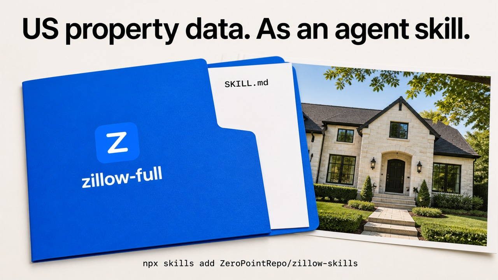
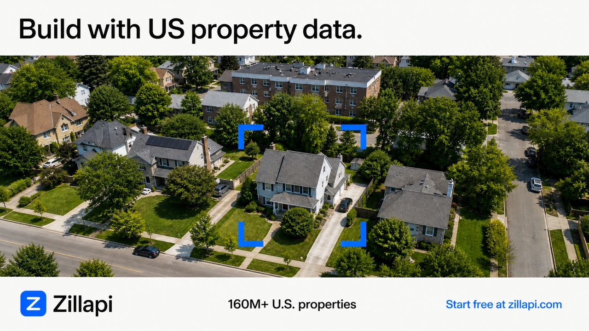

# Zillow Skills: Property Data, Zestimates & Listings for AI Agents

Zillow Skills let your AI agent **run comps, pull Zestimates, and scan for-sale, sold & rental listings** across 160M+ U.S. homes, plus photos, taxes, schools, and full price history, just by asking. No code required.

Zillapi is an independent service for Zillow-sourced data, not affiliated with, endorsed by, or sponsored by Zillow.

Free to use: [grab a key](https://zillapi.com/signup/) (100 credits, no card required) and you're calling Zillow data from Claude, ChatGPT, OpenClaw, Hermes Agent, or your own agent loop in under two minutes.

Pure Python standard library. No dependencies. MIT-0 licensed.

## Install

```bash
# OpenClaw (via ClawHub)
npx clawhub@latest install zillow-full

# Hermes Agent
hermes skills install skills-sh/ZeroPointRepo/zillow-skills/skills/zillow-full

# Generic agent skills (Claude Code, Cursor, Cline)
npx skills add ZeroPointRepo/zillow-skills
```

## Skills in this repo

| Skill | Purpose | Cost |
|---|---|---|
| [`zillow-full`](skills/zillow-full) | Complete property data toolkit: address lookup, URL lookup, Zestimate, search, history, photos, schools, agent | 1 to 3 credits per call (address lookup 3, or 1 if no property matches; other calls 1) |
| [`zillow-zestimate`](skills/zillow-zestimate) | Zestimate-only valuation lookups (lighter response) | 1 credit per call |
| [`zillow-search`](skills/zillow-search) | Bounding-box and location-based listing search | 1 credit per listing returned |

Install the bundled `zillow-full` for agents that need broad coverage. Install the focused variants when you want minimum tool surface.

## Authentication

Set the `ZILLAPI_KEY` environment variable to your Zillapi API key (format `zk_...`).

```bash
export ZILLAPI_KEY="zk_..."
```

**[Get a free key in 30 seconds](https://zillapi.com/signup/)**: 100 credits, no card required. The same key works for these skills, the [hosted MCP server](https://api.zillapi.com/mcp), and direct REST calls.

## Pricing

Free tier: 100 credits at signup, no credit card. One credit equals one property record returned. Failed calls do not consume credits. Full pricing: [zillapi.com/pricing](https://zillapi.com/pricing/).

## Source

- API reference: <https://zillapi.com/openapi.json>
- Hosted MCP server: <https://api.zillapi.com/mcp>
- Quickstart: <https://zillapi.com/quickstart/>

## Issues and contributions

See [CONTRIBUTING.md](CONTRIBUTING.md). Security reports: [SECURITY.md](SECURITY.md).

## Related Zillapi projects

- [zillow-api](https://github.com/ZeroPointRepo/zillow-api): REST API docs and examples
- [zillow-mcp](https://github.com/ZeroPointRepo/zillow-mcp): MCP server for Claude, ChatGPT, Cursor and Claude Code
- [zillow-skills](https://github.com/ZeroPointRepo/zillow-skills): agent skills (one-command install)
- [zillow-plugin](https://github.com/ZeroPointRepo/zillow-plugin): plugin for Claude Code and Cursor
- [n8n-nodes-zillapi](https://github.com/ZeroPointRepo/n8n-nodes-zillapi): n8n community node
- [crewai-zillapi](https://github.com/zillapi/crewai-zillapi): CrewAI tools
- Examples: [zillapi-vercel-ai-sdk-example](https://github.com/ZeroPointRepo/zillapi-vercel-ai-sdk-example) (Vercel AI SDK), [zillapi-openai-agents-example](https://github.com/ZeroPointRepo/zillapi-openai-agents-example) (OpenAI Agents SDK)
- Demos: [property-fair-value](https://github.com/ZeroPointRepo/property-fair-value), [property-scanner](https://github.com/ZeroPointRepo/property-scanner)

Learn more: [Zillow API guide](https://zillapi.com/zillow-api/) · [For AI agents](https://zillapi.com/ai-agents/) · [Pricing](https://zillapi.com/pricing/) · [Zillow API alternatives](https://zillapi.com/alternatives/zillow-api/) · [Zillow's Claude connector vs Zillapi](https://zillapi.com/compare/zillow-claude-connector-vs-zillapi/) · [Zillow API pricing explained](https://zillapi.com/blog/zillow-api-pricing/) · [YouTube](https://www.youtube.com/@zillapi)

## License

[MIT No Attribution](LICENSE). Fork, ship, sublicense with no attribution required.

## Trademark

Zillapi is an independent service and is not affiliated with, endorsed by, or sponsored by Zillow Group, Inc. "Zillow" and "Zestimate" are registered trademarks of Zillow Group, Inc.

---

[](https://zillapi.com/signup/)
